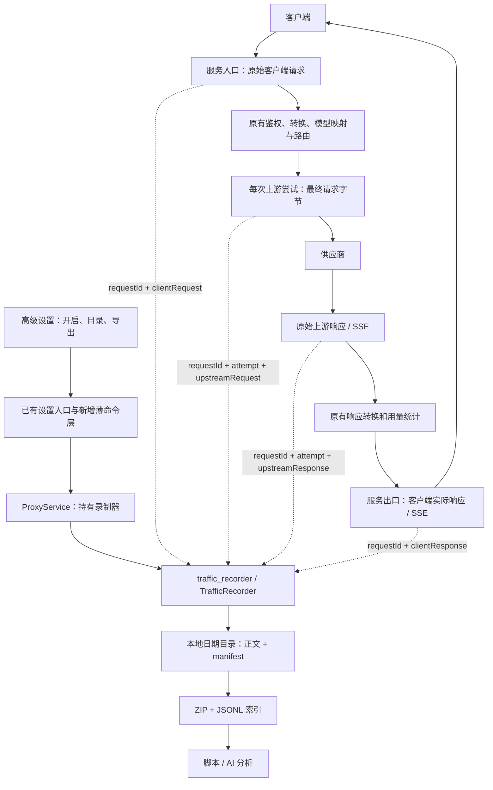
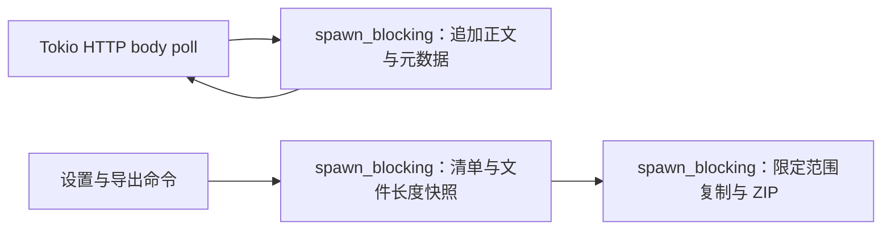

# CC Switch 原始流量录制与导出设计

[FIX 2026-10-25-01] Native installer validation and bounded Step 4 implementation repair; approved feature interfaces and module decomposition remain fixed.

状态：Phase 1 已于 2026-10-24 获用户“继续，并完成测试”授权；按同一外部契约继续内部设计、实现与验证。本文件是唯一设计文档。

源码基线：`farion1231/cc-switch` 的 `main`，提交 `309c9c5154e6d7f19b64ab4da6041da323ff9a42`。

## Requirement

在同一个 CC Switch 应用内，保留现有供应商、密钥、模型和客户端配置切换功能，新增原始 HTTP 请求、响应以及 SSE 正文的自动本地录制和文件导出。导出数据供脚本或 AI 分析，不新增人工日志分析界面。

### 成功标准

1. 用户显式开启后，经过 CC Switch 本地路由的模型 API 请求自动录制；关闭时不产生录制文件。未经过本地路由的直连流量不在可见范围内。
2. 每次客户端调用使用独立 `request_id`；每次上游重试或故障转移使用独立 `attempt`，不覆盖前一次尝试。
3. 同时保留客户端侧和供应商侧的请求、响应正文，区分协议转换、模型映射、整流前后的数据。
4. 正文以收到或发出的 HTTP body 字节为准。SSE 不解析后重建、不合并成回答文本，保留事件字段、分隔符、注释和收到的尾部数据。
5. 流中断、客户端断开、上游错误、录制失败、应用退出时的未完成记录保留为不完整记录，不能标成正常完成。HTTP 错误响应也录制。
6. 数据按日期分目录，不采用仅保留当天的策略，不因预览、采样或正文长度预算静默截断。
7. 导出为 ZIP，包含可供程序读取的 JSONL 索引、清单和原始正文文件；正文从打开录制起就自动落盘，导出不承担首次保存职责。
8. 原始指应用层 HTTP body，不包括 TLS 密文、HTTP 分块编码、TCP 包边界或逐包网络抓包。压缩正文保留捕获边界实际观察到的字节，并注明编码。
9. 请求头和 URL 元数据中的认证凭据脱敏；Prompt、工具定义、正文图片等保持原文。开启界面明确告知正文将被保存到本机，数据不纳入现有云同步。

## Architecture

### Phase 1 Review Checkpoint

本阶段仅冻结职责、外部接口、数据对象、文件位置及跨模块数据流。内部线程模型、初始化实现、函数伪代码和测试设计在本阶段获批后补充。

### Existing Baseline Vs New Requirement

#### 已有基线

- `src-tauri/src/proxy/server.rs`：本地 HTTP 服务和路由的生命周期。
- `src-tauri/src/proxy/handlers.rs`：客户端正文读取、解码、各协议入口及返回路径。
- `src-tauri/src/proxy/forwarder.rs`：模型映射、请求转换、上游发送、重试、故障转移。
- `src-tauri/src/proxy/hyper_client.rs`：Hyper / Reqwest 响应的统一正文接口。
- `src-tauri/src/proxy/response_processor.rs`：普通响应与 SSE 转发、用量提取。
- `src-tauri/src/proxy/usage/logger.rs`：现有统计记录，不保存原始正文；保持其现有职责。
- `src-tauri/src/settings.rs`：设备级设置，不随 SQLite 云同步。
- `src/components/settings/SettingsPage.tsx`：已有高级设置入口。

#### 本次增量

- 新增一个内置原始流量录制模块，负责正文持久化、关联清单和 ZIP 导出。
- 在服务入口/出口和上游请求/响应边界接入录制，不把正文加入诊断日志。
- 新增设备级录制开关、保存目录与导出操作；不新增查询面板、模型评测或协议转换能力。
- 复用已有 `bytes`、`chrono`、`serde`、`uuid`、`sha2`、`zip` 和文件选择组件；不新增第三方依赖。

### Modules

#### 1. 配置与操作入口：沿用现有 Settings / Commands / ProxyService

负责持久化设备级录制设置、选择保存位置、启停录制与导出。代理服务持有录制器，现有设置界面只暴露用户需要的开关和文件操作。

#### 2. 代理边界：沿用现有 Proxy

负责在客户端入站、客户端出站和每次上游尝试的入站/出站边界交付原始字节及元数据。协议转换继续由原有代码负责。

#### 3. 新增 `traffic_recorder` 模块

目录：`src-tauri/src/proxy/traffic_recorder/`。

唯一入口文件：`traffic_recorder.rs`；入口对象：`TrafficRecorder`。在 `proxy/mod.rs` 使用路径模块声明引入该入口。模块外部仅使用入口文件公开的对象，不访问内部细节；本期不拆出子模块。

### File Locations

| 状态 | 路径 | 对外职责或修改点 |
| --- | --- | --- |
| 新增 | `src-tauri/src/proxy/traffic_recorder/traffic_recorder.rs` | 录制器入口、数据对象、持久化和导出 |
| 修改 | `src-tauri/src/proxy/mod.rs` | 注册唯一模块入口 |
| 修改 | `src-tauri/src/services/proxy.rs` | 录制器生命周期和配置/导出服务入口 |
| 修改 | `src-tauri/src/proxy/server.rs` | 客户端请求/响应边界及请求级 ID |
| 修改 | `src-tauri/src/proxy/handler_context.rs` | 透传同一请求 ID 和录制关联对象 |
| 修改 | `src-tauri/src/proxy/forwarder.rs` | 每次实际上游发送及其响应，包含失败尝试 |
| 修改 | `src-tauri/src/proxy/hyper_client.rs` | 确保流式和非流式读取均可保留捕获边界正文 |
| 修改 | `src-tauri/src/settings.rs` | `trafficRecording` 设备级设置及兼容默认值 |
| 修改 | `src-tauri/src/commands/settings.rs` | 全量设置保存保留专用录制命令已更新的字段，避免旧缓存回写 |
| 新增 | `src-tauri/src/commands/traffic_recording.rs` | 薄层设置/导出命令，调用 ProxyService |
| 修改 | `src-tauri/src/commands/mod.rs`、`src-tauri/src/lib.rs` | 命令注册及退出时收尾 |
| 修改 | `src/types.ts`、`src/lib/api/settings.ts` | 录制配置和导出结果的前后端契约 |
| 新增 | `src/components/settings/TrafficRecordingSection.tsx` | 开关、目录选择、打开目录、导出按钮 |
| 修改 | `src/components/settings/SettingsPage.tsx` | 接入高级设置，不增加分析页面 |
| 修改 | `src/i18n/locales/{zh,zh-TW,en,ja}.json` | 四语言用户可见文本 |
| 修改 | `docs/user-manual/{zh,en,ja}/4-proxy/4.4-usage.md` | 录制、保存位置、导出和完整性语义 |

测试位置待 Phase 2 之后按接口制定；本阶段不创建测试或实现文件。

### Public Interfaces

以下为拟实现的 Rust 接口声明，均位于 `src-tauri/src/proxy/traffic_recorder/traffic_recorder.rs`。签名用于审查接口，不是本阶段已编译的实现。

```rust
/// 单个应用内共享的录制器；ProxyService 拥有它，代理只借用其接口。
pub(crate) struct TrafficRecorder { /* 私有状态 */ }

impl TrafficRecorder {
    /// 创建录制器；设置未启用时不创建正文目录。
    pub(crate) async fn open(config: TrafficRecordingConfig) -> Result<Self, AppError>;

    /// 更新后续新录制的设置；已开始的录制保持其原目录和关联关系。
    pub(crate) async fn reconfigure(&self, config: TrafficRecordingConfig) -> Result<(), AppError>;

    /// 开始一个边界正文的录制；关闭时返回 None，开启时返回独占句柄。
    pub(crate) async fn begin(&self, meta: CaptureMetadata) -> Result<Option<TrafficCapture>, AppError>;

    /// 将现有归档生成一致的 ZIP 快照；目标位于归档目录之外，默认不覆盖。
    pub(crate) async fn export(&self, target: PathBuf) -> Result<TrafficExport, AppError>;

    /// 停止接收新录制并收尾；不能确认完成的正文保持未完成状态。
    pub(crate) async fn shutdown(&self) -> Result<(), AppError>;
}

/// 单个边界正文的独占生命周期句柄；禁止跨正文或尝试复用。
pub(crate) struct TrafficCapture { /* 私有状态 */ }

impl TrafficCapture {
    /// 按调用顺序交付正文原始字节；不改变传入内容，不重建 SSE。
    pub(crate) async fn write(&mut self, bytes: Bytes) -> Result<(), AppError>;

    /// 消费句柄并保存结局；未调用 finish 的记录不能算完整。
    pub(crate) async fn finish(self, outcome: CaptureOutcome) -> Result<(), AppError>;
}
```

前后端命令位于 `src-tauri/src/commands/traffic_recording.rs`，前端入口位于 `src/lib/api/settings.ts`：

```typescript
/** 设备级配置；enabled 默认为 false，directory 为空时使用应用数据目录。 */
export interface TrafficRecordingConfig {
  enabled: boolean;
  directory?: string;
}

/** ZIP 文件信息；部分记录数量单列，不能把“导出成功”理解为“所有调用完整”。 */
export interface TrafficExport {
  path: string;
  requestCount: number;
  incompleteCount: number;
}

/** Tauri: set_traffic_recording_config；失败时设置和界面保持原值。 */
setTrafficRecordingConfig(config: TrafficRecordingConfig): Promise<void>;

/** Tauri: export_traffic_recordings；target 由现有保存文件对话框选择。 */
exportTrafficRecordings(target: string): Promise<TrafficExport>;
```

沿用现有 `get_settings` 读取 `trafficRecording`，不增加重复的读取入口。

### Public Visible Objects

以下对象全部定义于录制器唯一入口中；`AppError`、`Bytes`、`HeaderMap`、`PathBuf` 复用现有类型。配置作为公开 `AppSettings` 字段的类型保持公开，其余接口限于 crate 内部。前后端配置按 camelCase 序列化。

```rust
/// 配置由设置层持久化；不会写入供应商配置或云同步数据库。
pub struct TrafficRecordingConfig {
    /// 用户显式允许录制；默认 false。
    pub enabled: bool,
    /// 可选本地根目录；None 使用应用数据目录中的 raw-traffic。
    pub directory: Option<PathBuf>,
}

/// 同一次调用的四个可独立比较的捕获边界。
pub(crate) enum CaptureStage {
    ClientRequest,
    UpstreamRequest,
    UpstreamResponse,
    ClientResponse,
}

/// begin 的输入；调用方拥有字段，录制器保存脱敏后的元数据副本。
pub(crate) struct CaptureMetadata {
    /// 同一次客户端调用的稳定 UUID，不采用客户端可控值作为磁盘路径。
    pub request_id: String,
    /// 客户端调用开始时间；四个边界和全部重试使用同一值来确定日期目录。
    pub started_at: chrono::DateTime<chrono::Local>,
    /// 上游尝试从 1 开始；客户端边界使用 None。
    pub attempt: Option<u32>,
    /// 正文属于哪个方向及协议转换边界。
    pub stage: CaptureStage,
    /// 已知时填写所属应用和供应商 ID，未知时不得编造。
    pub app_type: Option<String>,
    pub provider_id: Option<String>,
    /// 实际边界的 HTTP 方法、URL、状态码及头；敏感值不进入归档元数据。
    pub method: Option<String>,
    pub url: Option<String>,
    pub status: Option<u16>,
    pub headers: http::HeaderMap,
}

/// 正文观察结果；成功收到 HTTP 4xx/5xx 的完整正文仍可为 Complete，
/// 其业务错误由 HTTP 状态区分；读流失败、取消和录制失败分别标识。
pub(crate) enum CaptureOutcome {
    Complete,
    Interrupted { reason: String },
    ReadFailed { reason: String },
    RecordingFailed { reason: String },
}

/// 导出操作结果，供命令层序列化给 UI。
pub(crate) struct TrafficExport {
    /// 已完成写入的 ZIP 绝对路径。
    pub path: PathBuf,
    /// 请求级记录数，以及其中至少有一个不完整边界的请求数。
    pub request_count: u64,
    pub incomplete_count: u64,
}
```

#### 导出文件契约

- `index.jsonl`：每行一个请求，包含 `schemaVersion: 1`、`requestId`、开始时间、应用、关联目录、HTTP 结果和请求级完整性。
- 每个请求一个 `manifest.json`：包含四个边界和全部上游尝试的关联信息；每个正文条目记录相对文件名、实际字节数、SHA-256、内容类型/编码、结局及错误原因。
- 正文文件原样存储，不把图片替换为占位符。未压缩 SSE 使用 `.sse`；其他正文使用 `.body`，不得把压缩二进制伪装成可读 SSE。
- 目录结构为 `YYYY-MM-DD/<request-id>/client/` 与 `YYYY-MM-DD/<request-id>/attempts/<attempt>/`；日期取调用开始时的本地日期，跨午夜的同一调用不拆成两条。
- 请求已开始但某次上游响应未出现时，清单说明未观察到响应，不能用空文件冒充完整响应。
- 导出包括失败和未完成的记录。导出期间仍在进行的调用以明确的部分快照导出，不中断或等待整个模型生成完成。
- 导出范围为当前设置的录制目录。更换目录不移动或删除旧目录，也不跨目录自动搜集历史数据；已有调用继续写入其开始时的目录。
- 新版本读取旧设置时录制默认关闭；归档不会自动随普通用量记录清理，不加入数据库备份或 WebDAV/S3 同步。

### How To Use

#### 用户操作

1. 在高级设置开启“原始流量录制”，选择保存目录；界面明确说明会保存 Prompt 和模型输出。
2. 使用现有本地路由和供应商切换功能，录制自动进行。
3. 点击“打开录制目录”访问原始文件，或“导出 ZIP”获得可交给程序分析的归档。
4. 关闭录制只影响后续调用，不删除已保存数据；已有调用完成其原录制生命周期。

#### 上层调用示例

调用位置为 `src-tauri/src/proxy/server.rs` 和 `src-tauri/src/proxy/forwarder.rs`；元数据字段与上文一致。

```rust
// 关闭录制时返回 None；开启时交付该边界实际观察到的同一份 Bytes。
if let Some(mut capture) = recorder.begin(metadata).await? {
    capture.write(original_bytes.clone()).await?;
    capture.finish(CaptureOutcome::Complete).await?;
}
```

这是录制模块调用示例，不代表代理应使用 `?` 将录制错误返回客户端。实际接入必须隔离录制错误：保持现有 HTTP 结果，在归档清单或现有诊断日志中标记录制不完整。流式接入逐块交付收到的原始字节；客户端断开时不得使用 `Complete`。

### Data-Flow Diagram



### Modification Map

#### 配置到代理

`SettingsPage / TrafficRecordingSection` → `settingsApi` → 新命令 → `ProxyService` → `TrafficRecorder`。持久化仍由现有设备级设置层执行；保存失败需要保持旧设置。`commands/settings.rs` 的全量保存合并逻辑保留专用命令更新的录制字段，防止其他设置页面用旧缓存覆盖。原有供应商、MCP、用量和云同步行为不扩展。

#### 请求到上游

`server.rs` 为客户端请求创建不受客户端控制的请求 ID，在协议解析前保留正文；关联对象及同一调用开始时间经 request extensions / `RequestContext` 传入转发器。`forwarder.rs` 在每次实际发送前记录最终请求，不以转换前 JSON 重新序列化充当客户端原始请求。

#### 上游到客户端

`forwarder.rs` / `hyper_client.rs` 捕获上游原始响应，覆盖 Hyper、Reqwest、非 2xx、重试和压缩路径；`server.rs` 的最终出站边界捕获实际返回客户端的数据。录制接入在用量提取与 SSE 重建之前，不依赖开启调试日志，也不依赖 token usage 事件出现。

#### 生命周期与失败

录制不能把原本成功的 HTTP 请求变为失败。容量不足或写盘失败时不能静默当作完整记录；保持可识别的未完成状态和错误提示。应用正常退出尝试收尾；异常退出后仍能识别上次未完成记录。内部实现和资源边界在 Phase 2 设计，不能据此声称进程崩溃或磁盘故障下绝对无损。

### Stop For Inspection

待审阅本文件的范围、四个录制边界、公开接口和导出契约。Phase 1 批准前，不创建生产代码、测试文件或实现骨架。

待 Phase 1 批准后，仍在本文件补充 Phase 2：详细数据流、线程模型、初始化骨架和每个公开函数的伪代码；完整设计获批后再进入接口测试设计、Mock 验证、实现和检查。

## GitHub 交付约定

- 开发 Fork：`arroncipher/cc-switch`。
- 分支：`feat-raw-traffic-recording`，基于上述上游 `main`；名称使用当前环境允许的字符。
- 当前阶段只提交设计文档，不伪装为已实现功能。
- 先查询已有上游 Issue 并准备相应功能说明；上游规范要求功能 PR 有关联 Issue。
- 实现完成后遵循仓库 PR 模板，附实际测试结果；不自动合并。

### Phase 2 Internal Design

#### Data Flow

1. `ProxyService` 延迟创建共享录制器，代理启动时注入 `ProxyState`；未启用时不创建归档目录。设置保存使用专用命令并保护全量设置合并。
2. `server.rs` 在 Router 前后包裹 HTTP body frame，保留数据帧和 trailer，逐块录制客户端正文。通过 request extensions 携带录制器、原始 `CaptureMetadata` 和请求级原子尝试计数器，不改变客户端请求头。
3. `forwarder.rs` 每次实际发送前分配 attempt，写入最终发送字节；Hyper 和 Reqwest 共用这一边界。收到响应后立即将其包装成原始字节流，在任何状态检查、解压、协议转换和重试前录制。
4. `TrafficCapture` 独占正文句柄，顺序写入并计算 SHA-256。begin 时清单已是未完成，finish 在刷盘后原子更新清单；Drop/退出保留 interrupted 状态。
5. 导出先获取已写入字节和清单的一致快照，再复制限定字节范围、生成索引和 ZIP。进行中的记录使用部分状态，禁止把之后追加的数据混入快照。

#### Thread Model

代理沿用 Tokio。录制模块全部常规文件操作经 `spawn_blocking`，写入调用等待该块落到操作系统文件层，保证有界流动和顺序，不用无界队列，也不在请求运行时线程直接做常规文件 I/O。共享状态的互斥锁只保护文件操作和清单快照。导出的 ZIP 压缩在快照之后独立执行。捕获错误被边界接入隔离，不替换 HTTP 结果。无 runtime 的 Drop 收尾允许同步落下中断状态。

#### Thread Diagram



#### Init Code Skeletons

```rust
// src-tauri/src/services/proxy.rs：只在实际需要时初始化，共享给当前代理实例。
let recorder = self.traffic_recorder.get_or_try_init(|| async {
    TrafficRecorder::open(crate::settings::get_settings().traffic_recording)
        .await.map(Arc::new)
}).await?;
let server = ProxyServer::new(config, db, app_handle)
    .with_traffic_recorder(recorder.clone());
```

#### Public Function Pseudocode Supplements

`src-tauri/src/proxy/traffic_recorder/traffic_recorder.rs`：

```text
TrafficRecorder.open: resolve device-local directory; validate enabled config; create empty owner state.
TrafficRecorder.reconfigure: validate new directory before publishing config; preserve existing capture paths.
TrafficRecorder.begin: validate generated UUID and stage/attempt; create body exclusively; persist incomplete manifest; return owned capture.
TrafficRecorder.export: snapshot manifests and written byte lengths; reject symlinks/unsafe paths/self-export/overwrite; copy snapshot bytes; produce JSONL and atomically publish ZIP.
TrafficRecorder.shutdown: reject new captures; flush active bodies and mark interrupted; retain completed data.
TrafficCapture.write: append bytes in order; update count/hash; report disk failure without changing the network stream.
TrafficCapture.finish: flush/sync body; save outcome, size and hash; atomically update manifest; consume handle.
```

`src-tauri/src/commands/traffic_recording.rs`：设置命令先验证/应用再持久化，持久化失败回滚；导出命令只转发给服务并返回结构化结果。

## Test Strategy

优先覆盖原文保真和失败可见性，再覆盖设置和导出操作；不把模型回答质量作为测试目标。Mock 先验证断行、UTF-8、二进制和预期导出契约，实际实现完成后用同一批数据验证文件与网络两侧逐字节一致。

### End-to-End Flow Coverage

本地假上游 → 现有 ProxyServer → 客户端；覆盖普通响应、SSE、401/500、重试、gzip、客户端提前断开和录制目录不可写。关闭录制时现有响应不变且无归档目录。开启时验证客户端与上游四个边界、全部 attempt、ZIP 正文和 manifest 的 SHA-256。

### Module Test Matrix

| 边界 | 测试位置 | 检查内容 |
| --- | --- | --- |
| open / reconfigure | `traffic_recorder/traffic_recorder.rs` 内部测试 | 默认关闭、非法目录、旧录制继续原目录、已有数据保留 |
| begin / write / finish | 同上 | 原始 JSON 空白、分片 UTF-8、SSE 注释/CRLF/尾片、二进制、空正文、重试独立、超预览大小 |
| 失败与生命周期 | 同上及 `proxy/server.rs` 内部测试 | Drop、shutdown、读流失败、写盘失败不改变 HTTP、未出现的响应不伪造 |
| export | 录制器内部测试 | JSONL/ZIP/hash 一致、进行中快照、跨日保留、拒绝覆盖、自包含路径、symlink/路径穿越 |
| Settings / Commands | `commands/settings.rs` 现有测试与新命令测试 | 缺失字段默认关闭、旧缓存不能覆盖录制设置、失败回滚 |
| UI | `tests/components/TrafficRecordingSection.test.tsx` | 开关、目录选择、保存/导出失败、取消操作、调用参数 |

### Test Cases

按上述数据流逐项实现测试；Rust 新录制模块的行覆盖率目标至少 70%。仓库规定检查为 TypeScript 类型检查、前端格式、前端单测、前端构建，以及 Rust 格式、Clippy 和后端测试。所有后端测试指定 `CC_SWITCH_TEST_HOME` 到本轮临时目录，避免接触真实客户端配置。

## Implementation and verification receipt — 2026-10-25

### Delivered behavior

- Device-local opt-in settings and a dedicated Settings → Data panel; English, Simplified/Traditional Chinese, Japanese and Turkish labels are included.
- Four independently stored HTTP body boundaries, correlated by UUID, with separate numbered upstream attempts. Existing handler extensions and `ProxyResponse::bytes_stream` already provide the required handoff, so no additional handler-context or hyper-client production changes were necessary.
- JSON whitespace, binary/compressed bodies and SSE delimiters/comments/fragmented UTF-8 remain original bytes. HTTP transfer framing, original header casing, TLS packets and chunk timing are outside the body-recording contract.
- File writes run on blocking workers with awaited backpressure, without an unbounded chunk queue. Files are retained until manually removed. Existing captures keep their original file paths when the configured folder changes; export scans the currently selected folder.
- Manifests begin incomplete and finalize with size, SHA-256 and outcome. HTTP bodies that signal end-of-stream on their last frame finalize before returning that frame, including empty bodies that Hyper may never poll. Dropped or failed streams remain incomplete.
- ZIP export snapshots the observed prefix, includes raw bodies, manifests and `index.jsonl`, rejects overwrite/self-export/path traversal/symlinks, and verifies completed bodies against their recorded hashes. Metadata credentials are redacted; bodies intentionally are not.
- Dedicated configuration updates preserve the setting against stale general-settings saves. Invalid configuration does not replace the current recorder configuration; persistence failures attempt rollback. Proxy startup disables an unavailable recorder, and recording errors do not fail an HTTP request.

### Executed checks

All backend commands used a dedicated `CC_SWITCH_TEST_HOME`; no real CLI configurations were used. Network fixtures bind only to loopback and use no real model APIs.

| Check | Command | Result |
| --- | --- | --- |
| TypeScript | `pnpm typecheck` | Passed |
| Frontend format | `pnpm format:check` | Passed |
| Frontend tests | `TZ=Etc/GMT+12 NODE_OPTIONS=--no-experimental-webstorage pnpm exec vitest run` | 256 files, 3301 tests passed |
| Frontend production build | `pnpm build:renderer` | Passed; existing bundle-size advisory remains |
| Rust format | `cargo +stable fmt --check` | Passed |
| Rust lint | `cargo +stable clippy -- -D warnings` | Passed |
| Rust full suite | `cargo +stable test` with inherited proxy environment variables unset | 18 test binaries, 4266 passed, 0 failed, 11 existing ignored tests |
| Recorder coverage | `cargo +stable llvm-cov test --lib --no-report traffic_recorder`, then `cargo +stable llvm-cov report --lcov` | 7 recorder tests passed; production-only lines 541/570 = **94.91%**, excluding the `#[cfg(test)]` section |

The local Node version is 25.9.0. Its experimental global Web Storage changes the existing test harness's storage behavior, so it was disabled for the final frontend suite. An unrelated session-list test assumes that a timestamp one hour ago is still “today”; the full suite was run in a timezone where that fixture remains within the current day. No unrelated production code or tests were changed for these environment issues.

### Feature-specific evidence

- Seven recorder tests cover default-off/no-directory behavior; configuration validation; exact JSON/SSE/binary content; repeated-header redaction; SHA-256/ZIP/index agreement; 51 MiB chunked content; duplicate boundaries and attempt validation; read/write/drop/shutdown failure states; directory changes; active-prefix export; tamper detection; private Unix permissions; unsafe paths, symlinks and schemas.
- A real loopback proxy test compares all four recorded boundaries against what the client sent/received and what the mock upstream received/sent, including gzip, SSE and HTTP 401. Replacing the recording folder with a regular file verifies that a recording failure leaves the HTTP response successful and unchanged.
- A real upstream failover test preserves HTTP 500 from the first provider and HTTP 200 from the second provider as separate attempts, verifying request payloads, provider identity, status and completion.
- Body-stream tests verify first-frame delivery and persistence before EOF, trailer preservation, read errors and interruption on dropping an unfinished body.
- Settings regression test verifies backward-compatible default-off and stale-save protection; six UI tests cover toggling, failure rollback, directory selection/cancellation, ZIP selection/cancellation and error reporting.

### Validation limits

Validated on macOS with Rust 1.95.0 and the repository's pinned pnpm 10.12.3. Windows/Linux execution, a signed desktop installer and a manual graphical smoke test were not performed. Recording is restricted to traffic actually traversing the local proxy. Exact bodies can contain private data, and slow/full disks require user attention; there is no automatic retention cleanup or content-analysis dashboard.

## [FIX 2026-10-25-01] macOS installer validation and export-dialog repair

[FIX 2026-10-25-01] Bug / earliest broken step: native macOS validation showed the shared `save_file_dialog` implementation in `src-tauri/src/commands/import_export.rs` always selected SQL. Traffic export therefore proposed `.zip.sql`. This is a Step 4 implementation defect under the existing ZIP-export contract; the public command signatures, feature scope and module boundaries stay unchanged.

[FIX 2026-10-25-01] Repair: the existing command selects the ZIP filter for a `.zip` default filename and preserves the SQL filter for SQL backups. A new regression test first failed against the SQL-only implementation, then passed for lowercase/uppercase ZIP and SQL backup names. No new command or frontend API was added.

[FIX 2026-10-25-01] Test correction: the original OAuth `replacement_closes_the_previous_keep_alive_connection` test failed twice in optimized builds because reqwest reused an idle connection while the previous server's FIN was arriving. The test now keeps an explicit Hyper connection alive, awaits server-side closure, and then checks the new callback with a fresh client connection. OAuth production behavior is unchanged; the assertion is stronger and no sleep or skipped test was introduced.

[FIX 2026-10-25-01] Build: a release-optimized Apple Silicon `.app` named **CC Switch Raw Traffic**, bundle ID `com.arroncipher.ccswitch.rawtraffic`, was ad-hoc signed and packaged into a compressed DMG. The original Tauri DMG decoration script failed while waiting for Finder automation; a standard `hdiutil create -format UDZO` image with an Applications link was generated instead. Image verification, read-only mount, clean install copy, arm64 inspection and strict code-signature verification all passed. Apple notarization was not performed.

[FIX 2026-10-25-01] Installed-app validation: launched the app copied from the final DMG with an isolated `CC_SWITCH_TEST_HOME`; started its proxy from the native UI; verified default-off creates no records; enabled recording from the native UI; verified the setting and old recordings survived quit/reinstall/relaunch; exercised JSON, gzip, fragmented SSE and HTTP 401 before and after restart. Eight requests produced 32 body files matching the client and upstream bytes, sizes and hashes. Header credential redaction and complete outcomes were checked.

[FIX 2026-10-25-01] Export validation: the corrected native Save dialog showed `.zip`, saved a real ZIP and displayed eight requests with zero incomplete. All 32 exported bodies and SHA-256 checksums matched the local originals. Cancelling the native folder picker left the configured folder unchanged. A visual smoke check confirmed the recording panel and success message rendered correctly. These checks supersede the earlier receipt's macOS installer and manual-GUI limitations; Windows/Linux remain untested.

[FIX 2026-10-25-01] Automated regression: `cargo +stable test --lib` passed **4059**, failed **0**, ignored **11** existing tests. `cargo +stable test --release --lib` passed **4059**, failed **0**, ignored **11**. The traffic panel, settings integration and import/export hook tests passed **29/29** across three files. Rust formatting, `git diff --check` and `cargo +stable clippy -- -D warnings` passed. The recorder source is unchanged, so its previously measured production coverage remains 94.91%.

[FIX 2026-10-25-01] Artifacts: `CC-Switch-Raw-Traffic-4.0.19-macOS-arm64.dmg`, `SHA256SUMS.txt`, a test-only `sample-traffic.zip`, and a verification report are saved outside the repository under this task's `artifacts/cc-switch-raw-traffic/` directory. Original installed CC Switch was not replaced by the test workflow, and no real model API was used.
